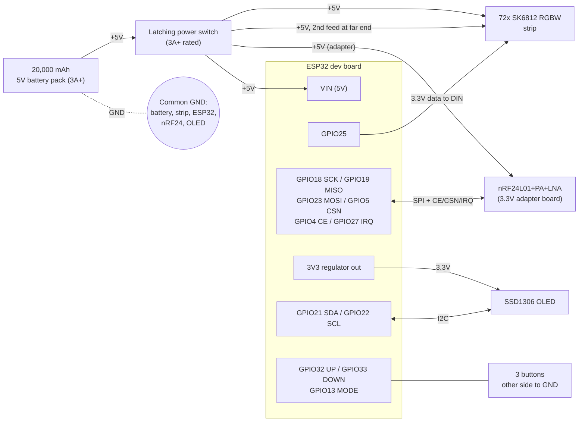

# DMX Giant Christmas Bulb

Retrofit a [Home Accents Holiday 3 ft Battery Operated LED Giant Bulb](https://www.homedepot.com/p/Home-Accents-Holiday-3-ft-Battery-Operated-LED-Giant-Bulb-24PA02589/329329471) with 72 RGBW LEDs, an ESP32, and an nRF24L01 radio. The bulb runs from a 20,000 mAh USB battery pack. It has dimmable static colors and simple color-change effects. It also takes wireless DMX from common nRF24-based transmitters (Donner-style), so it can sit in a lighting show with no cables.

## Features

- **Wireless DMX receiver.** Uses the nRF24L01+ protocol of the cheap "Donner"-style wireless DMX boards. The radio is receive-only.
- **Auto channel scan.** The firmware finds the transmitter's RF channel and color group (1-7, or Auto) on its own. It remembers the last lock and tries it first on the next boot.
- **4-channel RGBW.** Set a DMX start address (1-509). Channels are R, G, B, W at addresses N to N+3.
- **Standalone color mode.** No transmitter is needed.
  - 12 static presets: Red, Orange, Gold, Warm White, Green, Pastel Mint, Teal, Pastel Blue, Blue, Purple, Hot Pink and Pastel Pink.
  - 5 effects: Fade (slow), Fade (fast), Step (slow), Step (fast) and Candle.
  - Brightness from 5% to 100%.
  - Smooth dimming. Fades use a 16-bit pipeline with temporal dithering, so low brightness doesn't look steppy.
- **Signal-loss handling.** If DMX stops, the bulb holds the last frame for 5 s, then fades to black over 1 s.
- **Current limiting.** Total LED current is capped in firmware to protect the battery pack and wiring.
- **Low power.** The CPU runs at 80 MHz, and Wi-Fi and Bluetooth are never started. The OLED turns off after 15 s idle, and any button wakes it.
- **Settings persist** in flash and are saved 2 s after the last change.

## Hardware

| Part | Notes |
|------|-------|
| ESP32 dev board (EL-SM-012, 30-pin) | Powered from 5 V on VIN |
| nRF24L01+PA+LNA | Receive only, 3.3 V logic |
| 72x SK6812 RGBW LEDs | 5 V, GRBW order, single data line |
| SSD1306 0.96" I2C OLED | 128x64, 3.3 V |
| 3x momentary buttons | UP, DOWN, MODE, each to GND |
| 20,000 mAh USB power bank | Must supply 5 V at 3 A or more |
| Latching power switch | In the +5V line between the power bank and the whole circuit. Rate it for 3 A or more (for example a latching pushbutton or a toggle/rocker switch). |
| Bulb shell | The Home Depot 3 ft giant bulb, with its original electronics removed |

## Wiring



All grounds must be common: battery, strip, ESP32, nRF24 and OLED.

### Pin map

| Function       | ESP32 GPIO | Goes to                          |
|----------------|-----------:|----------------------------------|
| nRF24 SCK      | 18         | nRF SCK                          |
| nRF24 MISO     | 19         | nRF MISO                         |
| nRF24 MOSI     | 23         | nRF MOSI                         |
| nRF24 CSN      | 5          | nRF CSN                          |
| nRF24 CE       | 4          | nRF CE                           |
| nRF24 IRQ      | 27         | nRF IRQ                          |
| OLED SDA / SCL | 21 / 22    | OLED SDA / SCL (3.3 V)           |
| LED data       | 25         | Strip DIN                        |
| Button UP      | 32         | Button to GND (internal pull-up) |
| Button DOWN    | 33         | Button to GND                    |
| Button MODE    | 13         | Button to GND                    |

### Power

```
 5V battery pack (>=3A)
   |
 [latching power switch, >=3A, in the +5V line]
   |
   +--> SK6812 strip +5V / GND
   |        (also feed the far end of the strip with a second +5V/GND wire)
   +--> ESP32 VIN (5V)  -> onboard regulator -> 3V3
   |                                      |
   |                                      +--> OLED VCC
   |                                      +--> nRF24 VCC (see note)
 ALL GNDs common: battery, strip, ESP32, nRF24, OLED.
```

- Feed the strip from both ends with a second +5V/GND wire at the far end. This limits voltage drop and color shift along 72 pixels.
- Firmware caps LED current with `LED_MAX_MA` in `src/config.h`. That budget is shared with the ESP32, radio and OLED (about 0.15 A).
- The latching switch cuts +5V to everything: the strip, ESP32, radio and OLED. Nothing draws power when it is off, so the bulb can be stored with the power bank attached.
- Switch only the +5V line. Ground stays common and connected.
- SK6812s draw roughly 1 mA each even when black, about 70 mA for 72. With the switch off this doesn't matter. If you want a "dark but still listening" state, switch the strip's +5V with a logic-level P-MOSFET driven from a spare GPIO.

### LED data line

GPIO25 connects directly to the strip's DIN:

```
GPIO25 --> strip DIN
```

- SK6812s at 5 V nominally want a logic-high of about 3.5 V, and the ESP32 outputs 3.3 V, so this is marginal. If the first pixels flicker or show wrong colors, a level shifter (e.g. 74AHCT125) is the usual fix.
- Keep the data wire short.

### nRF24L01+PA+LNA

- The PA+LNA module is power-hungry and noisy. The best option is the 3.3 V adapter board that normally ships with it, fed from 5 V.
- If you wire it directly to the ESP32 3V3, put a 10-100 uF capacitor plus a 0.1 uF capacitor right across the module's VCC/GND pins.
- The module is **3.3 V only**.
- The IRQ pin is optional, but the firmware uses it to avoid polling over SPI.

### Buttons

Wire each button between its GPIO and GND. No external resistors are needed, because the firmware enables the internal pull-ups.

## Using it

Press **MODE** to cycle through three screens. The OLED shows the current screen. If the display is asleep, the first button press only wakes it.

| Screen | UP / DOWN | Behavior |
|--------|-----------|----------|
| **DMX ADDRESS** | Change start address (1-509, hold to repeat) | The bulb follows DMX. The channels are R, G, B, W at addresses N to N+3. The top right shows `LOCK`, `SCAN` or `NO RADIO`. |
| **WIRELESS CHANNEL** | Choose color group: Auto, Red, Green, Yellow, Blue, Magenta, Cyan, White | Selects the transmitter's group. Auto cycles through groups 1-7 while scanning. The screen shows the locked RF channel. |
| **COLOR MODE** | Tap: previous/next preset or effect. Hold: brightness down/up in 5% steps (hold longer to repeat faster). | Standalone mode. DMX is ignored and the bulb plays the selected preset or effect. |

The bulb follows DMX on the first two screens and plays standalone on the third. Leaving it on the screen you want after setup is enough, because the selection is saved.

## Battery life

Measured with a 20,000 mAh power bank:

| Test | Result |
|------|--------|
| DMX screen, strip attached and fully dark, radio not attached (about 110 mA) | Stayed powered for 45+ minutes. The pack did not auto-shut-off at this low load. |
| Color mode, slow fade at 10% brightness | Ran 15+ minutes with no visible drop in the pack's charge indicator. |
| Full brightness, manually cycling color modes | Worked with no brownouts or voltage problems. |

A longer full-brightness run is still to do. Until then, these are rough estimates, since the pack is rated at 3.7 V and delivers roughly 12,000-13,000 mAh at 5 V:

| Load | Approximate runtime |
|------|--------------------:|
| Dark, about 110 mA | around 100 hours |
| Lit, about 1 A | around 12 hours |
| Lit at the `LED_MAX_MA` cap (2650 mA) | around 4-5 hours |


## Building

The project uses [PlatformIO](https://platformio.org/).

```sh
pio run                  # build
pio run -t upload        # flash over USB
```

Dependencies are pulled in by `platformio.ini`: RF24, Adafruit NeoPixel and U8g2.

## Configuration

Tunables live in `src/config.h`:

| Setting | Purpose |
|---------|---------|
| `NUM_PIXELS` | Number of LEDs |
| `LED_COLOR_ORDER` | Pixel byte order (SK6812 RGBW is usually GRBW) |
| `LED_MAX_MA` | Total LED current budget |
| `SIGNAL_HOLD_MS` / `SIGNAL_FADE_MS` | Time to hold the last frame and fade out after DMX loss |
| `OLED_TIMEOUT_MS` / `OLED_CONTRAST` | Display sleep time and brightness |
| `FADE_*_MS` / `STEP_*_MS` | Timing of the fade and step effects |
| Pin constants | GPIO assignments |

## Wireless DMX protocol

The receiver speaks the protocol used by cheap nRF24 wireless DMX boards (Donner-style). The settings are 250 kbps, CRC16, no auto-ack and a 32-byte payload. The 5-byte pipe address is `[rfChan, unitID, ~rfChan, ~unitID, rfChan+unitID]`. Each payload carries 28 DMX bytes.
